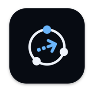
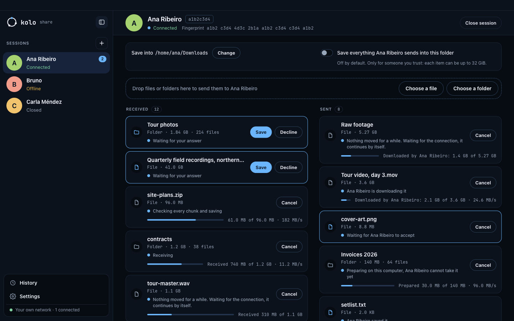

<p align="center"></p>

<h1 align="center">Kolo Share</h1>

<p align="center"><b>An example that connects two computers once with a pairing code, then sends files and folders both ways until one of you closes.</b></p>

<p align="center"><a href="https://github.com/ciranda-dev/kolo-share-wails3-example/releases">Download</a> · <a href="docs/how-it-works.md">Docs</a> · <a href="CHANGELOG.md">Changelog</a></p>

<p align="center"><a href="CHANGELOG.md"></a> <a href="LICENSE"></a> <a href="go.mod"></a> <a href="go.mod"></a> <a href="#platforms"></a></p>



## What it does

- **Connect once**: one person clicks Show a code, the other pastes it. The code works once and is never saved.
- **One window**: a sidebar with your sessions (it folds to a narrow rail), History, Settings and the network at a glance, and the session you pick on the right.
- **Send both ways** in the session: drop files or folders, no code per file, until one of you closes the session or the example. A dropped connection comes back by itself, and a download that was cut continues from what it already verified.
- **See it at once**: while a large item is being prepared, the other person's window already shows it ("Being prepared by Ana") with its progress, and the same row turns into the offer. A send says what it counts: prepared here, then downloaded by the other person.
- **Large items**: a file or folder of 100 GB or more is taken by default (the download limit is 1 TiB, `-max-download`). The disk is checked before the first byte, with how much is needed and how much is free; see [very large items](docs/how-it-works.md#very-large-items).
- **Fast on a long or lossy link**: the connection to the paired computer grows its receive windows for that peer only and paces what it sends with BBR. BBR takes bandwidth from other flows on a shallow queue: `-congestion reno` turns it off ([configuration](docs/configuration.md#congestion-control)).
- **Say where the time goes**: while a transfer runs, each example logs one `transfer:` line every 5 seconds with the speed, the requests in flight, the connection's round trip, congestion window and lost packets, and whether the wait is the network, the disk or memory. No names, only counts and sizes; `-quiet-transfers` turns the periodic lines off ([how to read a line](docs/how-it-works.md#what-a-transfer-log-line-says)).
- **Decide what lands on your disk**: every item waits for Save or Decline. Auto-save into a folder is off by default and only for the session you turn it on in.
- **Get exactly what was sent**: every chunk is checked against its hash, and the whole tree against what was offered, before it is saved.
- **Look back** at the last 50 transfers, also per person, and **follow** an incoming item in the menu bar or tray and on a Mac in the notch.

## Platforms

| Platform | Install | Version | Status |
|---|---|---|---|
| macOS (universal) | `.dmg` or `.zip` | v0.1.1 | Beta, unsigned |
| Windows (amd64, arm64) | installer `.exe`, `.exe` or `.zip` | v0.1.1 | Beta, unsigned |
| Linux (amd64, arm64) | `.deb` or `.tar.gz` | v0.1.1 | Beta, unsigned |

Get the files from the [latest release](https://github.com/ciranda-dev/kolo-share-wails3-example/releases), with `SHA256SUMS` to check them. They are not signed or notarized, so the system warns before the first run. Build your own with `scripts/release-local.sh` (see [build and test](docs/build-and-test.md)).

## Try it

You need Go 1.26+, Node.js with npm and the Wails 3 CLI (`go install github.com/wailsapp/wails/v3/cmd/wails3@v3.0.0`). Build once:

```sh
GOWORK=off wails3 build
```

### Two computers, public network

No flags: the example connects to the public network, which Ciranda runs. It is free and has no uptime guarantee while Kolo is a beta. Two computers on different networks find each other with nothing to set up.

```sh
./bin/kolo-share
```

On the first computer click Show a code and Copy code. On the second paste it and click Connect. If the public network cannot be reached (no internet, or no entry node answers), the window says so and names the other two ways: your own network with `-bootstrap`, or this computer only with `-local`. The example never switches network by itself.

### Same computer, `-local`

`-local` (or `KOLO_SHARE_LOCAL=1`) keeps everything on this computer: the window that opens first runs an entry node on `127.0.0.1:7451` and the others join it, in any order. Each window has its own data folder, which the example creates. `-local` cannot be combined with `-bootstrap` or `-first`.

Terminal 1: Alice.

```sh
./bin/kolo-share -local -data /tmp/kolo-share-demo/alice
```

Terminal 2: Bob.

```sh
./bin/kolo-share -local -data /tmp/kolo-share-demo/bob
```

In Alice's window click Show a code and Copy code. In Bob's window paste it and click Connect. Both windows now show the session: drop files or folders on either one, and the other clicks Save.

### Your own network, `-bootstrap`

Run your own [kolo-node](https://github.com/ciranda-dev/kolo-node) entry node and point the examples at it. With `-bootstrap` the example uses only your list and never the public network. Replace `<ip-of-computer-a>` with the node's address: a LAN IP such as `192.168.1.10` on one network, or a public address or name (a VPS, or a port forward of UDP 7447 on the router) on different networks.

Computer A: the entry node, on all its addresses with UDP port 7447 open.

```sh
kolo-node run -listen 0.0.0.0:7447 -identity "$HOME/kolo-node/node.key" -first
```

Computer A and computer B: the example.

```sh
./bin/kolo-share -bootstrap <ip-of-computer-a>:7447
```

If it does not connect:

1. `kolo-node check <ip-of-computer-a>:7447` prints `ok` on both computers.
2. Both examples were started with the same `-bootstrap` list, and no firewall blocks UDP.
3. The window that shows the code stays open; the other pastes all of it within its lifetime (1 hour, `-pair-ttl`).

Two computers behind strict NATs connect only through a relay both list ([Need a relay or a pin?](#need-a-relay-or-a-pin)). Firewalls, `KOLO_BOOTSTRAP` and every check are in [try it](docs/try-it.md). Tests: `GOWORK=off go test ./...`.

## Need a relay or a pin?

Kolo Share needs entry nodes: the public network has them by default, or you run your own and list them with `-bootstrap` ([Try it](#try-it)). The public servers are entry nodes only, so there is no public relay and no public pin.

- **Relay**: optional, for two computers behind strict NATs that cannot connect directly. When the direct connection fails, the pairing, the session and its files go through it. It carries them encrypted end to end and cannot read them.
- **Pin**: not used. A session moves files only while both examples are open.

A relay is needed only behind strict NATs, and you run your own on a host both computers reach, on UDP port 7448. It prints its key when it starts.

```sh
kolo-node relay -listen 0.0.0.0:7448 -identity "$HOME/kolo-node/relay.key"
```

Start both examples with the same relay, `host:port@key` with the key as 64 hex characters.

```sh
./bin/kolo-share -bootstrap <ip-of-computer-a>:7447 -relay <relay-host>:7448@<relay-key>
```

`-relay` repeats or takes a comma list, `-relay-file` reads one relay per line and `KOLO_SHARE_RELAYS` is used when neither flag is given. Entry nodes run with `kolo-node run` on UDP port 7447. Commands, ports and the relay's limits: [your own servers](docs/own-servers.md).

### With the installed macOS app

The installed app reads `KOLO_SHARE_RELAYS` from its environment, so start it from a terminal with your relay (replace the placeholders with your relay's address and its key, 64 hex characters):

```sh
KOLO_SHARE_RELAYS="<relay-host>:7448@<relay-key>" /Applications/kolo-share.app/Contents/MacOS/kolo-share
```

On other systems, set the same variable in the environment of the process before it starts. The flag `-relay` and the file `-relay-file` work the same way and win over the variable.

## How it uses Kolo

| Kolo library | What the example uses it for |
|---|---|
| [kolo-invite](https://github.com/ciranda-dev/kolo-invite) | the single-use pairing code and the exchange of keys it starts |
| [kolo-swarm](https://github.com/ciranda-dev/kolo-swarm) | finding the other computer, finding it again after a drop, and reaching it through a relay when a direct connection fails |
| [kolo-relay](https://github.com/ciranda-dev/kolo-relay) | through kolo-swarm: the relayed connection, end to end encrypted between the two examples |
| [kolo-secure](https://github.com/ciranda-dev/kolo-secure) | the authenticated, encrypted connection of a session, over kolo-transport (window growth for the paired peer, BBR) |
| [kolo-files](https://github.com/ciranda-dev/kolo-files) | the file or folder tree of each item |
| [kolo-blobs](https://github.com/ciranda-dev/kolo-blobs) | the file content, in chunks checked by hash |
| [kolo-sync](https://github.com/ciranda-dev/kolo-sync) | copying an item once its receiver said Save |
| [kolo-codec](https://github.com/ciranda-dev/kolo-codec) | the session's control messages |
| [kolo-dht](https://github.com/ciranda-dev/kolo-dht) | the public entry nodes, the entry node of `-local`, and the one `-first` runs |
| [kolo-log](https://github.com/ciranda-dev/kolo-log) | the signed logs that hold an item |
| [kolo-store](https://github.com/ciranda-dev/kolo-store) | keeping those logs on disk |
| [kolo-id](https://github.com/ciranda-dev/kolo-id) | the example's identity |

## Where the Kolo code is

- `shareservice.go`: the identity (`koloid`), the store (`kolostore.OpenPebble`), the swarm (`koloswarm.New`, with the relays in `Config.Relays`), the entry node of `-local` and `-first` (`kolodht`) and the sync server (`kolosync.NewServer`).
- `config.go`: the relay list (`koloswarm.ParseRelays`, `koloswarm.LoadRelays`).
- `relay.go`: the state of each relay, from kolo-swarm's `RelayChanged` events, for Settings and the terminal.
- `pair.go`: the pairing code (`invite.Code`), its topic (`koloswarm.JoinOptions`) and the key exchange over the `koloswarm.Conn`, direct or relayed, with `kolocodec` messages.
- `session.go`: the session topic, its connection as a `koloswarm.Conn` (direct or through a relay, used the same way) and the access each session peer gets (`kolosync.Access`).
- `offer.go`: an item as a `kolofiles` tree (`kolofiles.Create`, `kolofiles.OpenReader`) over `koloblobs.NewLogBackend`.
- `receive.go`: copying a saved item with `kolosync.Pull`, `FetchHeader` and `FetchHead`.

## Project layout

```text
main.go, config.go      start the app; flags, environment variables and defaults
shareservice.go         the network and the methods the window calls
pair.go                 the pairing code, both sides
session.go, control.go  a session: its connection, control messages and end
offer.go                sending and receiving an item in a session
errors.go               every error and its sentence
checkout.go             saving a received tree safely, copying the files on a few goroutines
space.go                the disk room a send or a receive needs, checked before it starts
store.go, store_later.go  the store of a transfer: tuned options, grouped commits
notch.go, tray.go       what the notch window and the tray show
report.go               writes a window's error to the terminal
frontend/src/App.jsx    the main window (React); Notch.jsx is the notch page
frontend/src/Crash.jsx  the error pane that replaces a blank window
```

## Learn more

- [Try it](docs/try-it.md), [your own servers](docs/own-servers.md), [how it works](docs/how-it-works.md), [configuration](docs/configuration.md), [notch and tray](docs/notch-and-tray.md)
- [Security](docs/security.md), [Go API and events](docs/api.md), [build and test](docs/build-and-test.md)
- [Changelog](CHANGELOG.md), [security policy](SECURITY.md), [license](LICENSE) (Apache-2.0)
