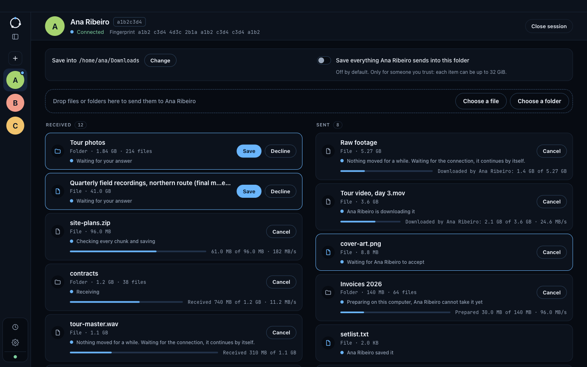
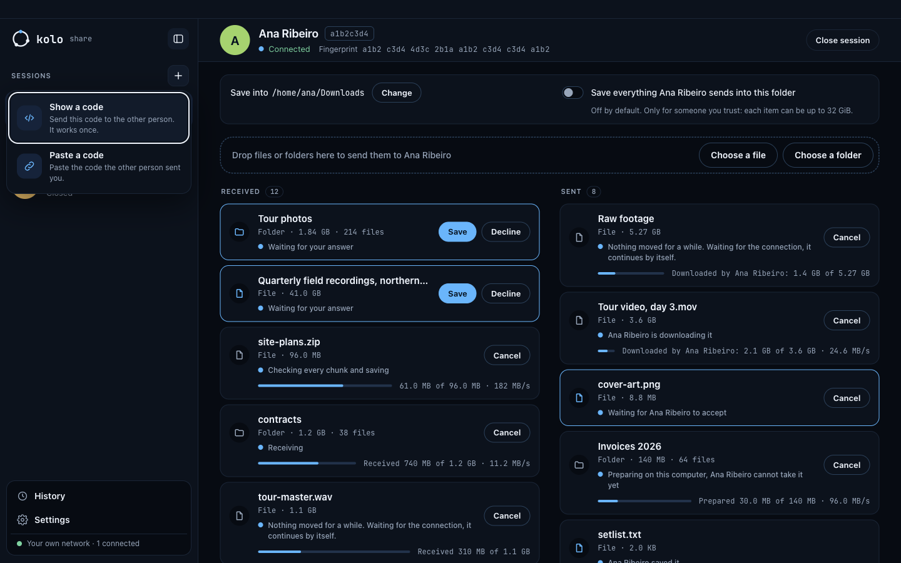

# How it works

Two people connect once with a pairing code. Then both can send files and folders, in both directions, until one of them closes the session or quits the example. Nobody types a code per file.

## The window



One sidebar on the left and one page on the right. The window is a single surface, and its text, colors and spacing follow the system theme or the one chosen in Settings.

- **Sidebar**: the Kolo mark and a button that folds it to a narrow rail of avatars (the choice is kept on this computer). **Sessions** has a "+" that opens a small menu with the two ways to connect: Show a code makes a pairing code with a Copy button and a countdown, and Paste a code takes the other person's code. Each opens a dialog (Escape, a click outside or Close ends it, and the focus goes back to "+"). One row per connected computer: a round avatar with the initial on a color made from its key, its name, Connected, Offline or Closed, and how many of its items wait for your answer. At the bottom, History and Settings, and one quiet line about the network: the public network, your own network or this computer only, and how many sessions are connected. The line never names an address.
- **Connect** page, shown while no session is open: what connecting is, and the same two ways.
- **Session** page: the name, the short key, whether it is connected, the fingerprint to compare, and Close session. Then the folder received items are saved into and the auto-save switch, the drop zone, and two lists of cards: Received on the left and Sent on the right, each with its state, a thin progress bar and its Save, Decline or Cancel, and the history of this person below.
- History and Settings pages, from the card at the bottom of the sidebar.



## Pairing

The pairing uses [kolo-invite](https://github.com/ciranda-dev/kolo-invite):

1. Alice clicks Show a code. Her example makes a key for this pairing only and an invite on that key: single use, alive for `-pair-ttl` (1 hour by default), kept in memory and never written to disk. It announces the invite's topic on a swarm of its own.
2. Bob pastes the code. His example looks up the topic, connects only to the key the code names, and sends a request signed with his example's key and his display name. It looks again every `-lookup-interval` (5 seconds by default) and dials again within the same time when a dial fails, until the connection works or `-find-timeout` (1 minute by default) ends with "Could not find the computer that made this code". The code stays valid on Alice's side, so Bob can paste it again.
3. Alice's example opens the session first, then answers by itself with her example's key, a new 32-byte session secret and her name, sealed to Bob's request; if the answer fails, the session goes again. It refuses its own key, a request past the session limit and requests while it quits.
4. The code is used up. It also ends at Cancel, when its dialog is closed, when it expires, and when the example quits.

Each side now knows the other's example key, from a signature or a sealed answer of the code's key.

## The session

- Both examples derive a swarm topic and a tag from the secret, one way, and do not keep the secret: it is cleared from the example's own buffers (Go cannot promise that no other copy stays in memory). Both announce and look up the topic on their main [kolo-swarm](https://github.com/ciranda-dev/kolo-swarm) swarm, and admit only each other's key.
- Each connection is a [kolo-secure](https://github.com/ciranda-dev/kolo-secure) one, direct or through a relay. Each side opens a control stream on it and says hello with the session's tag; a connection of an older session with the same person is closed.
- When the connection drops (network loss, sleep, the other example killed), the session shows "offline" and both examples keep dialing by themselves while it is open, again within `-lookup-interval` after a failed dial. Items that were waiting are offered again; an item the other side cancelled meanwhile is marked as cancelled.
- Two computers connect directly, with hole punching through the entry nodes. When that fails and both list a relay (`-relay`), kolo-swarm connects them through it: the connection is still kolo-secure from one example to the other, so the relay copies bytes it cannot read. The example uses both kinds of connection the same way, as a `koloswarm.Conn`: the control streams and kolo-sync run on it, and only the session's peer key is admitted.

## Sending an item

1. The sender stores the file or folder in a [kolo-files](https://github.com/ciranda-dev/kolo-files) volume: two kolo-store logs in a private folder of the data directory, removed when the item ends. Hidden files are sent like any other; links and special files are not, and the row says how many were skipped.
2. Before it stores anything, it announces the item when the peer reads announcements (see below): the other side shows "Being prepared by Alice" at once. The sender's own row shows "Prepared 1.2 GB of 5.3 GB": bytes read and stored on this computer, not bytes sent.
3. It offers the item on the control stream: kind, name, files and folders, bytes, and the volume's log. Only the session's peer may pull those logs, and only while the offer is open.
4. The other side sees "Bob wants to send you photo.jpg": the card that said it was being prepared turns into this offer. Nothing is written to its disk before Save. Once the peer pulls, the sender's row says "Downloaded by Bob: 2.0 GB of 5.3 GB".

A store is a Pebble database with its default options for an item under 64 MiB. A larger item gets a tuned store: a 256 MiB memtable and no compression of the blocks (they hold ciphertext, which does not compress), so a large item is prepared and received faster. Every store, large or small, groups its commits: a commit returns when it is queued, and the queue reaches the disk in larger writes, one sync for many chunks (see [very large items](#very-large-items)). The size is a file's size from a stat, a folder's from its scan, and for a receive the size in the offer. The example keeps at most 2 tuned stores open at a time, so the memory they add stays under 1 GiB (each can use up to twice its memtable); a large item that finds both taken uses the default options. The store is closed and its folder removed, and its place given back, when the item ends, whatever the way: delivered, declined, cancelled, failed or stopped with the session.

### Announcing an item that is still being prepared

Storing a large item takes a while, so the sender tells the peer first, on the control stream, with three small messages:

- `PREPARE`: the sender's transfer ID, the kind, the name and the bytes done of the total (0 when not known: a file's size is known from a stat, a folder's after its scan, which the sender never makes the peer wait for). It is sent when the preparation starts, then at most twice a second and only when a number changed, and every 30 seconds when nothing did, so a slow item is told apart from a lost sender.
- `READY`: the transfer ID and the ID of the offer that follows, so the card turns into that offer.
- `PREPEND`: the item ended before it was offered, cancelled or failed.

The receiver keeps at most `maxOpenOffers` cards, takes at most 60 new ones a minute, shows none for an item over its limits, checks every field like any control message and ends the session on a malformed one. A card that hears nothing for 2 minutes ends with `prepare-stalled`. After a reconnect the sender says its items being prepared again, and a card it does not say is removed, as for offers.

An older example ends the session on a message type it does not know, so the announcements are sent only to a peer that said it reads them: after its HELLO each example writes one frame of features on a second unidirectional stream (an older example refuses every stream after its control stream without reading it). A peer that never sends the frame gets the normal flow: the offer alone.

## Receiving an item

1. Save pulls the two logs with [kolo-sync](https://github.com/ciranda-dev/kolo-sync) on the session's connection. The signed heads must fit what was offered before a byte is pulled.
2. Every chunk is read through [kolo-blobs](https://github.com/ciranda-dev/kolo-blobs), checked against its hash.
3. The whole tree must be the one offered (name, files, folders and bytes), else nothing is saved.
4. It is saved into the session's folder (see [security.md](security.md) for how).

Up to 4 items of a session are received at once, and sends in the other direction run at the same time.

### When the connection is lost or slow

A receive that loses the connection, or whose pull stalls, does not end and does not ask for another click:

- The two replicas of the item stay in the receive's store, with every entry kolo-sync already verified. The next pull of the same offer asks only for the entries after them.
- The row says "Nothing moved for a while. Waiting for the connection, it continues by itself." as soon as the loss is known, or after 10 seconds without a byte, with no speed (the speed is measured over the last 5 seconds). The sender's row says the same while the peer is away.
- The receive tries again when the session's connection is back, and otherwise after 1 second, doubling up to 15, starting again at 1 second after a pull that moved.
- The sender keeps the offer open, and its guards serve the resumed pull on the new connection.
- It ends for good when the person presses Cancel, when the sender cancels or ends the offer, on a limit or an integrity error, or when no byte arrived for `-resume-for` (30 minutes by default): "Nothing came from the other computer for 30 min, so the transfer stopped. Nothing was saved." The partial copy is removed when the item ends. It is not kept across a restart of the example: a session lives in memory.

## Auto-save

Each session has a switch "Save everything {name} sends into this folder". It is off at the start of every session and never saved. Even while it is on, every limit applies, and items over a limit are declined.

## Ending a session

- **Close session** tells the other example, which shows "{name} closed the session", and waits at most 10 seconds for it. Quitting the example does the same for every session.
- A crash or a power loss tells nobody: the other side stays offline and keeps trying until its person closes the session.
- Every transfer of a session stops when it ends; nothing half written stays in the folder. An ended session stays in the sidebar, read only, until you dismiss it.

## Very large items

An item of 100 GB or more is taken by default: `-max-download` is 1 TiB, a safety bound that you can raise or lower, and it is the only size limit. What changes with the size is the disk, the time and what survives a break.

### Disk

An item is stored twice before it is saved, and the example asks for the room before the first byte, so a transfer of 100 GB does not fail after hours.

| Where | When | Room for an item of `S` bytes | For 100 GB |
|---|---|---|---|
| the sender's data folder | from the start of the preparation until the item is delivered, declined, cancelled or the session ends | `S` + 1/16 of `S` + 1 GiB (64 MiB under 64 MiB) | 107 GB |
| the receiver's data folder | from Save until the item is saved or the receive ends | the same | 107 GB |
| the folder the receiver chose | while the files are written, after the download | `S` + 16 MiB | 100 GB |

The receiver's two rooms add up when its data folder and the chosen folder are on one disk (207 GB for 100 GB). The sender keeps its copy until the other computer has the item, so a sender's disk holds the item once more besides the original. A store is about 1/16 of `S` and 1 GiB over `S` at most: measured stores of 3 and 4 GiB items held 3.97 and 4.95 GiB.

- The sender checks its data folder after it scanned the item and before it stores it: "Not enough free disk space to prepare this item: it needs 99.9 GiB in the data folder and only 37.3 GiB is free." (`no-space-prepare`).
- The receiver checks both rooms when the person presses Save (and when auto-save starts a receive), before the first byte is pulled: `no-space-download` (its data folder), `no-space-save` (the chosen folder) or `no-space-both` (one disk, with the advice to choose a folder on another one). The sentences are in English, Spanish and Portuguese and say how much is needed and how much is free, in binary units (100 GB is 93.1 GiB, and its store needs 99.9 GiB).
- Transfers that run together do not promise the same room twice: each holds its need until it ends, per disk, and the free space it sees is what the others left. The check is conservative: it counts the whole need of a running transfer, not only what it has still to write.
- A disk that fills up anyway, because another program wrote to it, ends the transfer with `disk-full` and the path, never with a raw error. A receive that already has everything pulled and then finds the chosen folder full ends that way too, and the download is lost: the check at Save is the guard against it.
- The data folder is where the room is needed first: start the example with `-data` on a large disk to move it.

### Time

A transfer has three stages, one after the other: the sender prepares the item (reads it, cuts it, encrypts it, stores it), the receiver pulls it into its store, and then writes the files. The row of each side says which stage it is in. The time is the sum of the three, so the slowest stage decides:

| Stage | What limits it | Measured on a Mac with an M5 chip and an SSD (other jobs were running on it), items of 1 to 4 GiB, both examples in one process, a link of 20 ms round trip with no limit |
|---|---|---|
| prepare | the disk's sync of each batch, then the CPU | 130 to 200 MB/s |
| pull | the link, the transport's window and the store | 31 to 36 MB/s measured with kolo-sync v0.1.7, which keeps 3 answers in flight; not measured again for an item of this size with the streamed pull of v0.1.8 |
| save | decrypting and writing the files | 270 to 440 MB/s |

At those speeds 100 GB takes about 100e9 / speed in each stage, as an extrapolation, not a measurement:

| Speed of one stage | 100 GB takes |
|---|---|
| 5 MB/s (a 50 Mbit/s uplink) | 5 h 33 min |
| 10 MB/s | 2 h 46 min |
| 15 MB/s | 1 h 51 min |
| 31 MB/s | 54 min |
| 50 MB/s | 33 min |
| 110 MB/s (a full 1 Gbit/s) | 15 min |
| 250 MB/s | 6 min 40 s |

The slowest stage today is the pull, and the `transfer:` line of the receiver says what holds it back ([below](#what-a-transfer-log-line-says)). For an item of 100 GB on the Mac above, over a link of 20 ms, expect about 46 to 54 min to pull, 12 min to prepare and 4 min to save. Many small files cost per file, not per byte: a folder of 99,000 files of 0.5 to 2.5 KiB (151 MB, `TestBenchManyFiles`, same link) was prepared in 38 s (2,575 files a second), pulled in 54 s (1,850 files a second) and saved in 9 s (10,800 files a second), with the sender's card kept alive by the heartbeat during the scan. Nothing in the example limits the speed by itself: the caps that remain are in [configuration](configuration.md#what-can-slow-a-transfer).

### What continues after a break, and what does not

- **Continues by itself**: a lost connection, a network change, a link that stalls, the other example's connection restarting, and a laptop that sleeps. The receive keeps what it already verified in its store and asks only for the rest, and the sender keeps the offer open. The time the computer sleeps does not count against `-resume-for`: the timer uses the monotonic clock, which stops during sleep (an item that was cut for an hour with the laptop closed goes on when it wakes).
- **Gives up**: when the person cancels, when the sender cancels or closes the session, on a limit or an integrity error, or when no byte arrived for `-resume-for` (30 minutes by default, up to 24 hours) while the computer was awake.
- **Does not survive a restart or a crash of either example.** A session lives in memory, the pairing code is never stored, and both stores are removed when the example starts, so after a restart the two people pair again and the sender prepares the item again from the start. This is a decision, not a bug: a stored partial copy would need the session secret or a new pairing to be trusted again, and the stores of a stopped example would sit on the disk, 100 GB each, until someone cleans them.
- **Preparation does not resume.** A send that is stopped while it prepares starts again from the first byte.

### What is not supported

- An item over `-max-download` (1 TiB by default) or with more than `-max-files` files and folders (100,000): it is declined at once.
- A transfer that must survive a restart of the example.
- Sending or receiving without room on the disks above. The example says so before it starts.
- A copy of the item that is not kept twice: the sender stores an encrypted copy of what it sends, and the receiver stores one before it writes the files. Both are part of how an item is verified chunk by chunk.

## The speed of a pull

A stream moves at most one receive window per round trip. The session connection starts every connection with kolo-transport's default 256 KiB window, and the paired peer's connection grows it to 4 MiB per stream and 8 MiB per connection while the example reads fast; kolo-swarm marks a connection for growth only once the example's `Allow` admitted its key, so a stranger's connection never grows. The connection also paces what it sends with BBR (`-congestion`), which keeps a link full where random loss makes Reno crawl. The memory the windows can hold, the connection counts that go with them and the cost of BBR to other traffic are in [configuration](configuration.md#receive-windows-and-connections).

Measured between two examples over simulated links (`KOLO_SHARE_BENCH=1 go test -run BenchLink`, `link_test.go` with `internal/netsim`, loss in each direction, a pull of the item into the receiver's store, the load average of the Mac 2.0 to 2.7, two runs each, MB/s):

| Path | kolo-transport defaults, Reno | flat 4 MiB and 8 MiB windows, Reno | growth and BBR (the example) |
|---|---|---|---|
| 100 ms, 100 Mbit/s, no loss (100 MiB) | 1.94, 1.94 | 9.32, 9.43 | 9.17, 9.37 |
| 100 ms, 20 Mbit/s, 1 percent loss | 0.25, 0.24 | 0.24, 0.24 | 2.29, 2.27 |
| 60 ms, 20 Mbit/s, 3 percent loss | 0.21, 0.20 | 0.20, 0.20 | 2.26, 2.27 |

The lossy rows run 100 MiB for growth and BBR and 20 MiB for the two Reno columns, since 100 MiB at 0.2 MB/s takes eight minutes; a smaller item includes more of the start, so those two columns are a little low. Without loss, growth reaches what flat windows give, about 9.3 MB/s of the 12.5 MB/s of the link (the pull verifies and stores each answer), and the defaults are held to about 2 MB/s by their window. With random loss the window is not the limit: Reno halves its rate at each loss and stays at 0.2 MB/s with any window, and BBR fills the 20 Mbit/s link (2.3 MB/s is 18 Mbit/s). The paths have independent random loss only, not the bursts, reordering or policers of a real network.

### Streamed or one answer at a time

kolo-sync v0.1.8 asks once for the entries and keeps the link full with credit, where v0.1.7 asked for the next answer when the first bytes of the one before arrived and so moved about one answer of 1 MiB per round trip. Between two examples over simulated links, growth and BBR as the example sets them, 100 MiB, two runs each, MB/s (kolo-sync v0.1.7 in the example v0.1.9, v0.1.8 in v0.1.10; the load average of the Mac 3 to 6.6):

| Path | one answer at a time (v0.1.7) | streamed (v0.1.8) |
|---|---|---|
| 30 ms, 100 Mbit/s, no loss | 11.45, 11.42 | 11.45, 11.44 |
| 30 ms, 20 Mbit/s, 1 percent loss | 2.35, 2.36 | 2.35, 2.36 |
| 100 ms, 100 Mbit/s, no loss | 9.44, 9.27 | 9.93, 10.09 |

At 30 ms the link is the limit in both, so a pull that is slow on such a link is not waiting for round trips. The streamed pull helps where the round trip is long, and a little under random loss on a long one.

## What a transfer log line says

While a transfer runs, each example writes lines that start with `transfer:` to its log (the standard error of the terminal it was started from), so one real run says where the time goes. They hold counts, sizes and times only, never a name, a key, an address or an error text. `-quiet-transfers` (`KOLO_SHARE_QUIET_TRANSFERS=1`) drops the lines that come every 5 seconds; the line at the end of each pull stays. To follow one transfer: `grep transfer:`.

The receiver writes a `transfer: recv` line every 5 seconds while it pulls and one when the pull ends. Each item is two pulls, a small one of its metadata and then the one of its content, so the first line you see in a run is the small one. A sample from the content pull of a 100 MiB item over a link of 30 ms, 20 Mbit/s and 1 percent loss, shown without the connection words that end every line (below):

```
transfer: recv state=running rate_mbs=2.33 avg_mbs=2.35 bytes=58849790 answers=48 avg_answer=1226037 streamed=true inflight_max=2 inflight_avg=2.0 first_byte_min=33ms commit_idle=24.417s commit_busy=203ms reader_wait=24.613s mem_blocked=0 mem_wait=0s elapsed=25s
```

| Word | Says | What it points to |
|---|---|---|
| `state` | `running`, or at the end `ok`, `error` or `canceled` | |
| `rate_mbs` | MB/s (1,000,000 bytes) over the time since the last line | what the transfer does now |
| `avg_mbs` | MB/s since the pull started | compare with a speed test of the sender's upload and your download: a number close to the slower of the two is the link |
| `bytes`, `answers`, `avg_answer` | the bytes of the answers read, how many, and their average size | |
| `streamed` | `true` when the other example streams the entries | `false`: the other example is older and answers one request at a time, so about one answer of 1 MiB per round trip: update it |
| `inflight_max`, `inflight_avg` | requests for entries waiting, the most and the average (a request is 2 MiB of credit when streaming) | the pull keeps 2 to 8 waiting, as many as twice the round trip times the speed asks for; 8 all the time means the pull wants more than the link and the window give |
| `first_byte_min` | the shortest time from a request to the first bytes of its answer | about the round trip of the path; far above the ping means the sender is slow to read its log |
| `commit_idle`, `commit_busy`, `reader_wait` | time the store waited for an answer, time it spent verifying and storing, time the reader waited for bytes; all over the whole pull | `commit_idle` and `reader_wait` near `elapsed`: this computer waits for the network or the sender, not for its CPU or disk. `commit_busy` near `elapsed`: this computer is the limit |
| `mem_blocked`, `mem_wait` | times, and how long, the reader waited for room under the 6 MiB of answers a pull holds | above 0 with a high `commit_busy`: the disk or the CPU of the receiver is slower than the link |
| `elapsed` | time since the pull started | |
| `rtt`, `min_rtt` | the connection's smoothed and lowest round trip, to 100 microseconds | `rtt` far above `min_rtt` is a queue on the path filling up (BBR keeps one of 25 to 150 ms by design) |
| `cwnd`, `in_flight` | the congestion window of this computer's connection in bytes, and the bytes it sent that are not acknowledged yet | `in_flight` near `cwnd` all the time: the congestion controller sets the speed. This computer sends little in a receive, so the numbers that matter are the sender's |
| `pkts_sent`, `pkts_lost`, `bytes_lost` | packets this end sent, packets it counted lost (a late packet counts too) and their bytes | `pkts_lost` over `pkts_sent` is an upper bound of the loss rate of the path back to the sender |
| `cc` | the congestion controller of the connection: `bbr`, `cubic` or `reno` | the one of `-congestion` |
| `bw_mbs` | BBR's estimate of the bottleneck bandwidth in MB/s, there only when BBR measured one | |
| `path_changes` | how often the connection moved to a new network path | above 0: the other computer's address changed during the transfer, and the numbers started over |

The sender writes a `transfer: send` line every 5 seconds while it serves any pull, and one with `state=idle` when it stops. A sample from the same run, again without the connection words:

```
transfer: send state=running rate_mbs=2.27 avg_mbs=2.21 sent=33128795 streams=1 elapsed=15s
```

`rate_mbs` is MB/s sent in the last interval, `avg_mbs` and `sent` the speed and the bytes since the transfer began (the quiet time before the idle line is not counted; the first interval may include a few seconds before the first byte), `streams` the pulls being served, and `conns` how many session connections are open. The words after it are the connection numbers of the one connection that has sent the most (the same words as the receiver's, from the sender's side: `cwnd` and `in_flight` are what limits the upload). The bytes are what the example wrote to the connection, every frame included, so they run a little above the receiver's. If the sender's `rate_mbs` stays at the speed of its upload and the receiver's `commit_idle` is near `elapsed`, the upload is the limit and nothing in the example can raise it.

Both lines end with the connection words, which come from kolo-transport's `Conn.Stats`: the round trip, window, bytes in flight, losses and controller the connection itself measured, as a snapshot at the moment of the line. They are left out when the connection has ended. The end of a receive line from a pull of 2.4 MiB between two peers on 127.0.0.1 (a test, so the round trip is under a millisecond and the controller is kolo-secure's default, Reno):

```
... elapsed=145ms rtt=100µs min_rtt=0s cwnd=38400 in_flight=40 pkts_sent=602 pkts_lost=0 bytes_lost=0 cc=reno path_changes=0
```

On a send line the same words follow `elapsed` after ` conns=N`.

## How many at once

| Bound | Value | Why |
|---|---|---|
| sessions | 16 | kolo-swarm's default topic limit, one topic per session |
| pairings | 1 | one code at a time per example |
| items waiting, per session and direction | 16 | kolo-sync serves 16 streams per connection, so each can be pulled |
| connections of the session swarm | 48 accepted, 64 dialed | the peers of 16 sessions, 16 hellos and 16 handshakes; 256 KiB of window each, and growth to 8 MiB for the paired peers within 124 MiB |
| new items per minute, per session | 60 | kolo-invite's rate for one source |
| bytes, files and folders per item | 1 TiB, 100,000 | `-max-download`, `-max-files` |
| receives at once, per session | 4 | each has its own streams and its own room on the disk |

An item past a limit is declined with one line in the session, never a popup, and is not written to the history.
